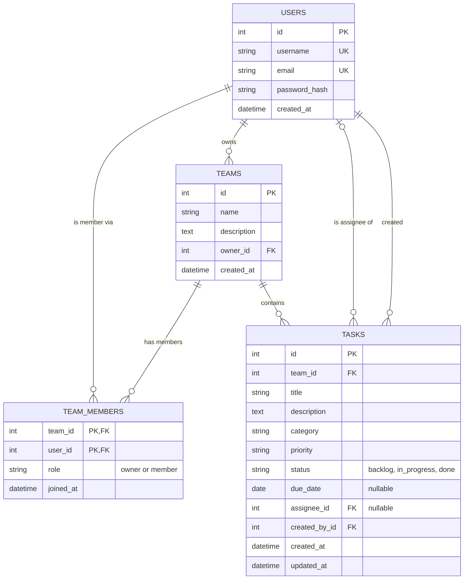
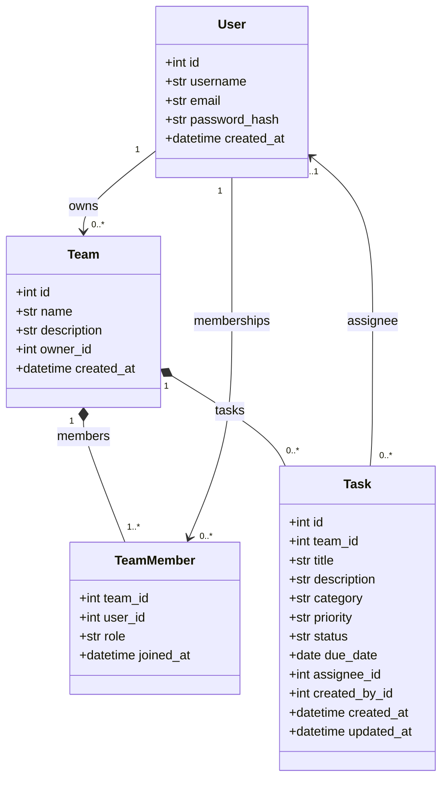
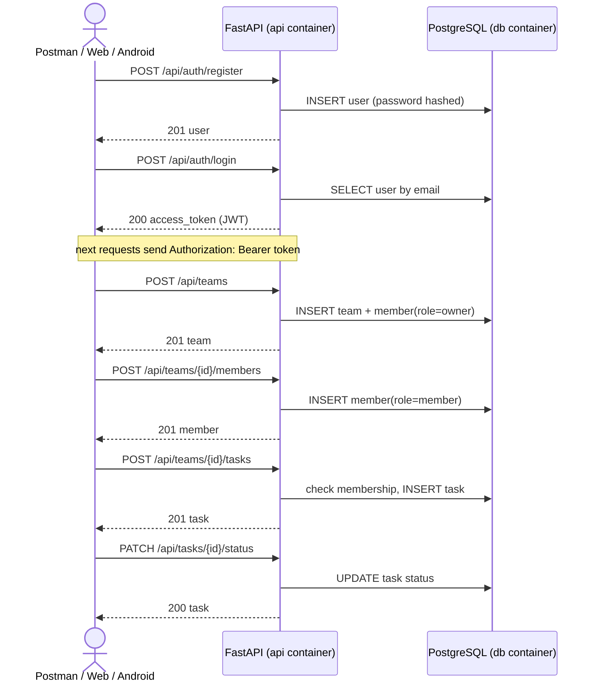
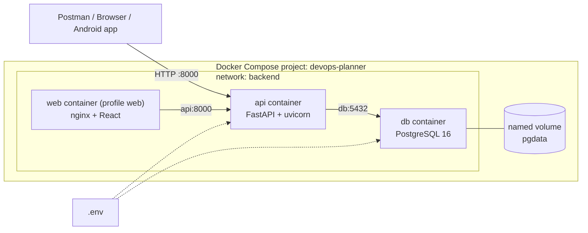

# Database and architecture diagrams

All diagrams are written in [Mermaid](https://mermaid.js.org/) and are rendered automatically by GitHub.
PlantUML versions of the class and sequence diagrams are in [`diagrams/`](diagrams/).

## 1. Entity-relationship diagram (PostgreSQL tables)

| Relationship | Type | Implementation |
|---|---|---|
| Team → Task | **one-to-many** | `tasks.team_id` FK; deleting a team deletes its tasks (ORM cascade) |
| Team → TeamMember | **one-to-many** | `team_members.team_id` FK; deleting a team deletes memberships |
| User ↔ Team | **many-to-many** | association table `team_members` (composite PK `team_id` + `user_id`) with an extra column `role` |
| User → Team (owner) | one-to-many | `teams.owner_id` FK |
| User → Task (assignee) | one-to-many, optional | `tasks.assignee_id` FK, nullable; removing a member sets it to `NULL` |
| User → Task (creator) | one-to-many | `tasks.created_by_id` FK |

## 2. Class diagram (SQLAlchemy models)

## 3. Sequence diagram (typical usage)

## 4. Deployment diagram (Docker Compose)

## Business rules enforced by the API
- Only team members can read or change the team's tasks (otherwise `403`).
- Only the team owner can rename or delete the team and add or remove members (otherwise `403`).
- The owner cannot be removed from the team (`400`).
- An assignee must be a member of the team (`422`).
- E-mail and username are unique (`409`); passwords are stored only as salted PBKDF2 hashes.
